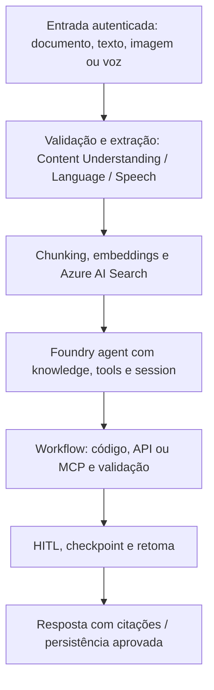

# Capstone — assistente empresarial multimodal

Estado: plano de implementação, sem recursos Azure criados. Base: manual v3, secções 21, 23–27 e 31. O cenário abaixo operacionaliza o capstone do manual; não representa uma solução já testada.

## Objetivo

Ingerir documentos empresariais, extrair campos, responder com evidência e executar ações controladas por aprovação humana. Incluir capacidades de texto, voz e imagem para consolidar os domínios do exame.

## Etapas e critérios de conclusão

| Etapa | Entrega | Evidência de aceitação | Manual |
| --- | --- | --- | --- |
| 1. Planeamento | Foundry resource/project, deployment e identidade | Decisões de modelo, região, quotas, RBAC e custos registadas | 4–5, 11 |
| 2. Ingestão | Dados de teste via Blob/SharePoint/API e metadata | Origem preservada, falhas registadas e input validado | 21, 31 |
| 3. Extração | Content Understanding analyzer/schema e validação | Campos esperados e output inválido testados | 13, 34.6 |
| 4. RAG | Chunking, embeddings e index Search | Comparação de retrieval; resposta com citações e ACL respeitadas | 23 |
| 5. Agent/tools | Agent principal, session e uma tool MCP | Argumentos e permissões validados antes da execução | 24 |
| 6. Workflow | Agent A → código/API → validação → Agent B → HITL | Retoma por checkpoint; ação sensível só após aprovação | 9, 25 |
| 7. Modalidades | Language PII/NER; Speech STT/TTS; Translator; Vision Q&A/alt text | Resultados estruturados e diferenças entre serviços explicadas | 12–13, 28 |
| 8. Geração | Demonstração de imagem com controlos de conteúdo | Safety/policy e custos registados; vídeo opcional | 13, 31 |
| 9. Operação | Dataset, tracing, métricas e análise de erros | Groundedness, relevance, safety, latência e custo medidos | 26–27 |

Voice Live e multi-agent são extensões quando o requisito justificar a complexidade; documentar a escolha (secções 10, 28 e 31).

## Validação e entrega

- Definir entradas e saídas esperadas antes de implementar e guardar resultados reais.
- Testar retrieval sem evidência, schema inválido, tool indisponível, permissões insuficientes, prompt injection e recusa de aprovação.
- Separar tempo de retrieval, modelo e tools; correlacionar chamadas com tracing.
- Registar custos observados e recursos a remover; definir orçamento pessoal antes do provisionamento.
- Entregar arquitetura, trade-offs, execução reproduzível, avaliação e limitações. Critérios numéricos de aceitação ficam por definir com dados reais.

